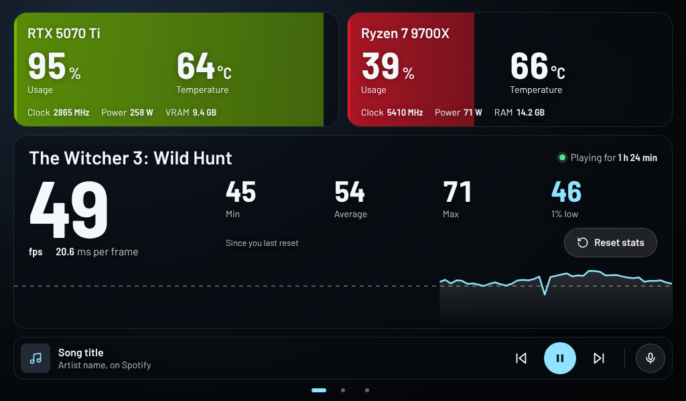
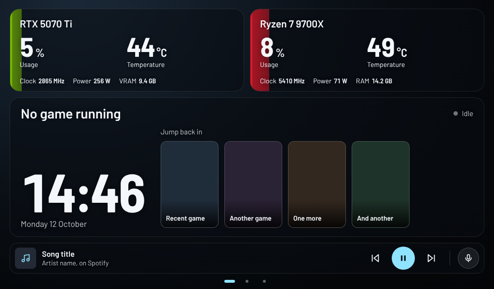
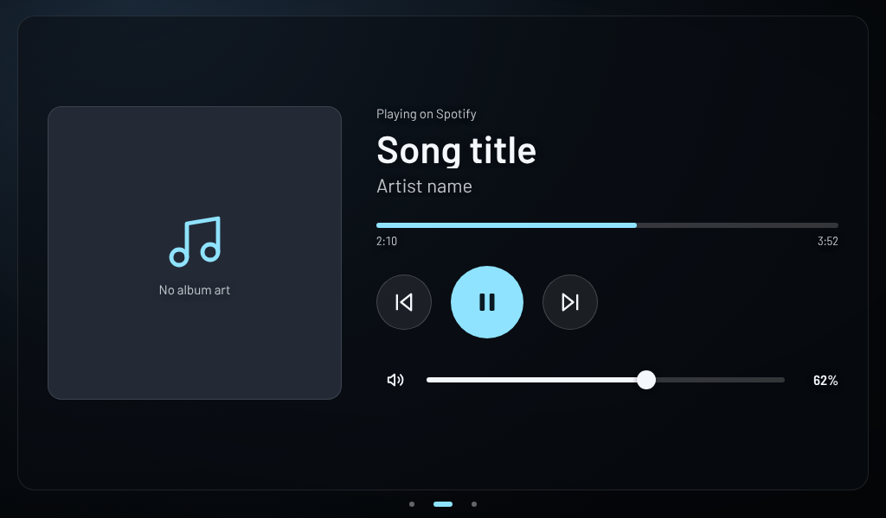
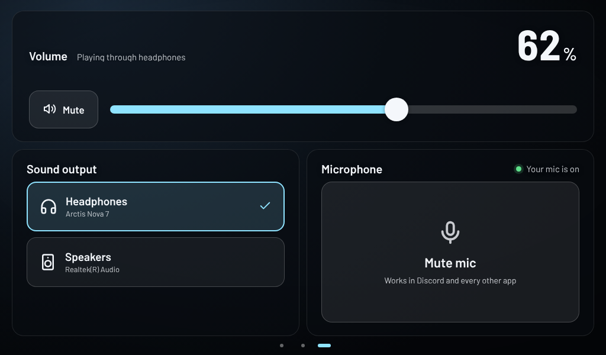

# PC Stats Dashboard

A touchscreen dashboard for a small second screen. While you play, it shows your GPU, CPU and FPS over the current game's artwork. Swipe across for music controls, then sound and mic controls.

It's built for a 1024×600 screen and scales to fit any size.

| No game running | Music | Sound and mic |
| --- | --- | --- |
|  |  |  |

## Features

**Stats**
- GPU and CPU cards with usage, temperature, clock, power and VRAM/RAM. Each card fills up with its usage level.
- Your GPU and CPU are detected automatically, and integrated graphics are skipped.
- Current FPS, frame time, Min, Average, Max and 1% low. These are the same numbers as your RivaTuner overlay.
- A 60-second FPS graph and a timer showing how long you've been playing.
- A **Reset stats** button that presses your RivaTuner reset key for you.
- An amber alert when the GPU or CPU runs hot.
- A summary when you close a game: play time, average FPS, 1% low and the hottest temperatures.

**Looks**
- The game's own Steam artwork as the background, with accent colours picked from it.
- Your desktop wallpaper and a clock when no game is running.

**Touch controls**
- Now playing, with album art and play/pause/skip. Works with Spotify, YouTube in a browser, and anything else in the Windows media controls.
- Volume, mute and a one-tap switch between sound outputs, such as headphones and speakers.
- Microphone mute that works in every app, Discord included.
- Your recently played Steam games, tap to launch.

**Stays out of the way**
- Lives in the tray instead of the taskbar or Alt+Tab.
- After a tap, focus and the mouse pointer go back to your game.
- Uses very little CPU and memory, and nothing is injected into games.

## Requirements

- Windows 10 or 11
- [Python](https://www.python.org/downloads/) 3.10 or newer (or run `winget install Python.Python.3.13`)
- [MSI Afterburner](https://www.msi.com/Landing/afterburner/graphics-cards) with RivaTuner Statistics Server, running
- Microsoft Edge (built into Windows) or Google Chrome
- Optional: [HWiNFO64](https://www.hwinfo.com/) with Shared Memory Support, for CPU temperatures Afterburner can't read
- Optional: Steam, for game names, artwork and recently played games

## Setup

1. **Download** this repository (Code → Download ZIP) and extract it somewhere permanent.
2. **Turn on the readings in Afterburner.** In MSI Afterburner → Settings → Monitoring, tick:
   GPU usage, GPU temperature, Core clock, Power, Memory usage, CPU usage, CPU temperature, CPU clock, RAM usage, Framerate, Framerate Min, Framerate Avg, Framerate Max and Framerate 1% Low.
   They don't need "Show in On-Screen Display".
3. **Set a reset key in RivaTuner.** In RivaTuner → Setup → Plugins, enable HotkeyHandler and set a key for **Begin recording**. Pressing it again later resets Min, Max and 1% low.
4. **Double-click `Start Dashboard.bat`.** The first start installs the music, sound and tray add-ons, which takes about a minute and only happens once. The dashboard opens on your smallest screen that isn't the main one.
5. **Match the reset key.** Open the `config.json` that was just created and set `reset_key` to the key from step 3, for example `"ctrl+alt+r"` or `"f9"`. It starts as `"ctrl+v"`.
6. **Tap the small screen once** to make the dashboard fill it.

To have it start when you sign in, double-click `Start With Windows.bat`.

## Using it

- **Pages:** swipe left and right, or tap the dots at the bottom, to move between Stats, Music, and Sound and mic.
- **Tray icon:** next to Afterburner's icon. Right-click it for Show dashboard, Reset stats and Stop dashboard.
- **Stopping:** use the tray icon or `Stop Dashboard.bat`.
- **Checking what it can see:** `Check Setup.bat` lists every reading it finds, plus your screens, the add-ons and your recent Steam games.

## Custom backgrounds

Steam games get their artwork automatically. For any other game, or to use a different picture, put an image in the `backgrounds` folder named after the game's .exe file. For example, `witcher3.jpg` for The Witcher 3.

A picture in this folder takes priority over the Steam artwork. Wide images look best, around 1920×620 or 16:9, and JPG, PNG and WEBP all work.

## Settings

`config.json` is created the first time you start the dashboard. Restart the dashboard after changing it.

| Setting | What it does |
| --- | --- |
| `reset_key` | The key the Reset button presses. Must match RivaTuner's Begin recording key, e.g. `"ctrl+alt+r"`, `"f9"`. |
| `screen` | `"auto"` picks your smallest non-main screen. Use `1`, `2`, `3`... to choose one; Check Setup shows the numbers. |
| `temp_warm`, `temp_hot` | Temperatures (°C) where readings turn amber, then pulse. Defaults: 75 and 87. |
| `recent_games` | How many recently played Steam games to show when idle. `0` hides them. |
| `game_names` | Rename games, e.g. `{"witcher3.exe": "The Witcher 3"}`. |
| `ignore_programs` | Programs that get picked up as games but aren't, e.g. `["someapp.exe"]`. |
| `gpu_name`, `cpu_name` | Different names for the cards. Leave empty for the detected names. |
| `hide_from_taskbar` | Keep the window out of the taskbar and Alt+Tab. |
| `keep_game_focused`, `give_focus_back` | Keep taps on the touchscreen from taking focus and the mouse pointer away from your game. |
| `download_steam_art` | Fetch artwork from Steam's servers when Steam hasn't saved it on your PC. |
| `idle_background` | `"wallpaper"`, `"none"`, or the path to an image, for when no game is running. |
| `port` | The local port the dashboard uses. Default: 8787. |

## Troubleshooting

- **CPU temperature is blank:** Afterburner can't read some newer CPUs. Run HWiNFO64 with Settings → Shared Memory Support ticked and the dashboard picks it up.
- **1% low shows "–":** tick Framerate 1% Low in Afterburner's Monitoring list.
- **Reset stats does nothing:** make sure `reset_key` matches RivaTuner's Begin recording key.
- **It opened on the wrong screen:** set `screen` in `config.json`.
- **Your RivaTuner overlay shows on the dashboard:** in RivaTuner, add a profile for `msedge.exe` and turn its on-screen display off.
- **A game pauses when you tap the screen:** Windows gives focus to whatever you touch. The dashboard hands focus straight back, but some games, such as The Witcher 3, still open their pause menu when they lose focus for a moment. Borderless windowed mode makes this less disruptive than exclusive fullscreen.
- **Music or sound says it needs the add-on:** run `Start Dashboard.bat` again while connected to the internet.

## How it works

- **Reading your hardware:** it reads the shared memory that MSI Afterburner, RivaTuner and HWiNFO already publish. It's read-only, and nothing is injected into games.
- **Finding the game:** the game is the 3D program RivaTuner is measuring, preferring the one in focus.
- **Names and artwork:** these come from Steam's own files on your PC, falling back to Steam's image servers.
- **Music, sound and mic:** these use Windows' media controls and audio settings, via [pywinrt](https://github.com/pywinrt/pywinrt) and [pycaw](https://github.com/AndreMiras/pycaw). The tray icon uses [pystray](https://github.com/moses-palmer/pystray).
- **Showing the page:** the dashboard is a local web page served on `127.0.0.1` and shown in a stripped-down Edge window. It only answers requests from your own PC, and its buttons can't be triggered by websites.

## Privacy

No stats are saved anywhere. The app only writes `config.json`, and Edge keeps a small separate profile for the dashboard window in `%LOCALAPPDATA%\PC-Stats-Dashboard`. Session summaries, music info and FPS history live in memory and disappear when it closes.

The only internet use is the one-time add-on install and Steam artwork downloads. You can turn the artwork downloads off with `download_steam_art`.

## Files

| File | What it is |
| --- | --- |
| `Start Dashboard.bat` | Starts the dashboard, and installs the add-ons the first time. |
| `Stop Dashboard.bat` | Stops it. |
| `Check Setup.bat` | Lists everything the dashboard can see. |
| `Start With Windows.bat` | Makes it start when you sign in. |
| `dashboard.py` | The main app: reads the sensors, finds the game, runs the local page and manages the window. |
| `dash_media.py` | Now playing and music controls. |
| `dash_audio.py` | Volume, sound output and microphone mute. |
| `dash_steam.py` | Recently played Steam games. |
| `dash_tray.py` | The tray icon. |
| `web/index.html` | The dashboard page itself. |
| `backgrounds/` | Your own background images (see Custom backgrounds). |

---

Not affiliated with MSI, Guru3D, NVIDIA, AMD, Valve or Microsoft. All product names belong to their owners.
